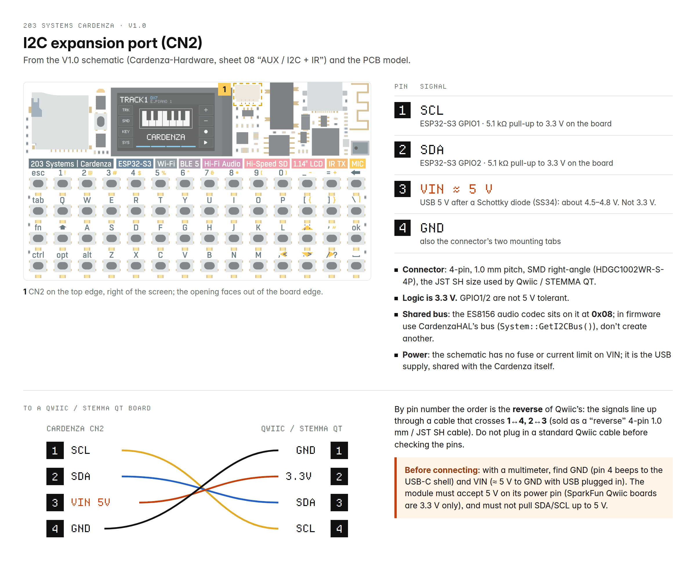

# Cardenza Hardware

The hardware of the 203 Systems Cardenza (ESP32-S3, 240 × 135 display, 56 keys with a light each, speaker, microphone, SD card, USB).
203 Systems Cardenza 的硬件资料（ESP32-S3、240 × 135 屏幕、56 个带灯按键、扬声器、麦克风、SD 卡、USB）。

- [Cardenza_V1.0_SCH.pdf](Cardenza_V1.0_SCH.pdf): V1.0 schematic / V1.0 原理图
- [Cardenza-PCB-3D.step](Cardenza-PCB-3D.step): the PCB's 3D model / PCB 3D 模型

## I2C port / I2C 接口

CN2, on the top edge right of the screen: a 4-pin, 1.0 mm pitch right-angle connector (the JST SH size of Qwiic / STEMMA QT).
Pin 1 SCL (GPIO1), 2 SDA (GPIO2), 3 VIN (USB 5 V after a Schottky diode, about 4.5–4.8 V, not 3.3 V), 4 GND. 3.3 V logic with
5.1 kΩ pull-ups on the board; the ES8156 codec shares the bus at 0x08. By pin number the order is the reverse of Qwiic's.

CN2 在屏幕右侧的上边缘：4 针、1.0 mm 间距的卧式插座（Qwiic / STEMMA QT 用的 JST SH 尺寸）。1 脚 SCL（GPIO1）、2 脚 SDA（GPIO2）、
3 脚 VIN（USB 5 V 经肖特基二极管，约 4.5–4.8 V，不是 3.3 V）、4 脚 GND。逻辑电平 3.3 V，板上 5.1 kΩ 上拉；ES8156 音频芯片也在这条总线上（0x08）。
按引脚编号，顺序和 Qwiic 相反。

## Links / 链接

| | |
|---|---|
| Website / 官网 | https://203.io/products/cardenza-mini-synthsiser |
| Learn / 教程 | https://cardenza.203.io ([中文](https://cardenza.203.io/zh-Hans/)) |
| Firmware community / 固件社区 | https://cardenza.203.io/community |
| Firmware / 固件（鸣片） | [CardenzaSynth](https://github.com/203-Systems/CardenzaSynth) |
| Hardware layer for your own firmware / 做自己的固件 | [CardenzaHAL](https://github.com/203-Systems/CardenzaHAL) |
